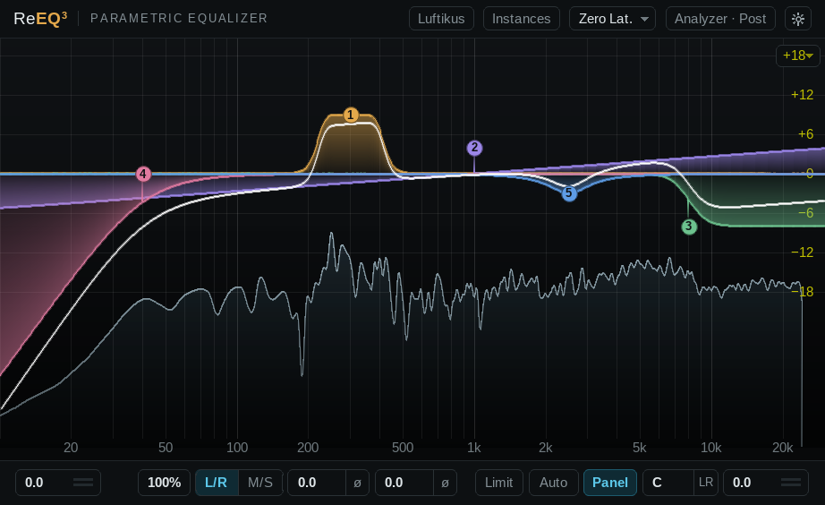

# ReEQ³

ReEQ³ es un ecualizador paramétrico JSFX para REAPER. Parte de **ReEQ² 2.2.0** de Justin Johnson ([ReJJ](https://github.com/Justin-Johnson/ReJJ), MIT) y le añade las funciones de FabFilter Pro‑Q 4 que se pueden hacer en JSFX. Conserva todo lo de ReEQ²: 16 bandas, filtros ajustados a la curva analógica hasta Nyquist, dinámica por banda con tres sidechains, lookahead, analizador y temas.

**Manual** (inglés y castellano): [ReEQ3-Manual-EN-ES.pdf](ReEQ3-Manual-EN-ES.pdf). Versión actual: **3.3.0**.

## Instalación

1. Copia la carpeta `ReEQ3` (con `Dependencies/` y `Themes/`) en `REAPER/Effects/ReJJ/ReEQ3/`. Es la ruta donde la busca el script de migración.
2. Copia los scripts de `Scripts/` en `REAPER/Scripts/` y cárgalos desde *Actions › New action › Load ReaScript*:
   - `ReEQ2 upgrade to ReEQ3.lua` pasa los ReEQ² (y ReEQ) del proyecto a ReEQ³ conservando todos sus ajustes.
   - `ReEQ3 Theme Editor.lua` es el editor de temas. Usa los mismos temas que ReEQ² (`Data/ReEQ2`), y las ventanas de ReEQ³ abiertas siguen los cambios en directo.
3. Requisitos: REAPER 7.45 o posterior (lo mismo que ReEQ² 2.2). La lista de instancias usa `get_host_placement`, disponible desde REAPER 6.74.

> Para escribir valores en la ventana del plugin, activa *Send all keyboard input to plug-in* en el menú de la ventana de FX. Si no, REAPER intercepta las teclas.

## Novedades respecto a ReEQ²

### Filtros

- **Ganancia de ±30 dB** en todas las bandas (antes era ±18).
- **Flat Tilt**, una forma nueva: pendiente constante en todo el rango, con pivote en la frecuencia de la banda. La ganancia es el nivel a cinco octavas del pivote, así que ±30 dB equivalen a ±6 dB/oct.
- **Pendientes en campanas y shelves**:
  - Shelves y Tilt Shelf: de 6 a 96 dB/oct. Son shelves de orden alto de Holters‑Zölzer; la Q da forma a la rodilla.
  - Campanas: de 12 a 96 dB/oct. La campana empinada es la transformación paso‑banda de un shelf de orden alto: el ancho a media ganancia sigue siendo el que fija la Q y los faldones caen con la pendiente elegida. A 12 dB/oct es exactamente la campana clásica de ReEQ².
  - Cortes: como antes, de 6 a 120 dB/oct.
- **Pendientes fraccionales** (por ejemplo, 15,6 dB/oct):
  - Shift mientras arrastras el dial de pendiente.
  - Ctrl+Shift+rueda sobre el nodo, en pasos de 1 dB/oct.
  - Ctrl+rueda sin Shift recorre los valores estándar.
  - El selector de forma y la tarjeta del botón derecho muestran la fila de pendientes en todas las formas que la tienen.
- **Interacción Gain‑Q analógica**: el botón `G·Q` en la cabecera del panel de las campanas. La Q se estrecha al subir la ganancia (el doble de estrecha a 15 dB), como en muchas consolas.

Todos los diseños corren sobre el motor de ReEQ², ampliado a 20 secciones por banda. El audio coincide con la curva analógica con un error de menos de 0,02 dB por debajo de 16 kHz (medido).

### Procesado (botón de la cabecera, junto a *Analyzer*)

- **Zero Latency / Linear Phase.** El modo de fase lineal usa un motor FFT con un FIR de fase lineal ajustado a la curva analógica. Resuelve las bandas L/R y M/S en una sola etapa (una matriz 2×2 por bin), así que la latencia no se duplica.
- **Resolución**: Low / Medium / High / Very High.
  - A 44,1/48 kHz, la latencia es de 3072 / 6144 / 12288 / 24576 muestras.
  - A 88,2 kHz o más, el marco se duplica, con un máximo de 16384 muestras.
  - REAPER compensa la latencia.
- **Character**: Clean / Subtle / Warm. Es una saturación asimétrica con pendiente unidad en cero, así que el material suave pasa limpio. El sesgo de continua se elimina.
- **Oversample 2×**: es el antiguo slider *Quality* de ReEQ². Añade 15 muestras de latencia.

### Dinámica

- **Umbral automático** (interruptor `A` bajo el knob Threshold). El umbral sigue el nivel a largo plazo del detector (unos 2 s) más 3 dB, de modo que solo dispara lo que sobresale del nivel habitual de la banda.
- **Dinámica espectral** (botón `SPEC` junto a `DYN`). Cada bin de la banda reacciona a su propio nivel y deja en paz el resto de la banda.
  - **Density**: 0 extiende cada disparo cerca de una octava; 100, cerca de 1/24 de octava.
  - **Tilt**: suma 3 dB/oct al disparo, como en Pro‑Q.
  - Las bandas espectrales siempre van por el motor FFT, a la resolución elegida. En Zero Latency, las demás bandas siguen siendo de fase mínima.
- En fase lineal, las bandas dinámicas funcionan además con cualquier pendiente.

### Analizador (popover *Analyzer*)

- **Freeze**: mantiene el máximo en el tiempo. Al desactivarlo se borra.
- **Spectrum Grab** (activado por defecto): apunta dentro del espectro y el pico más claro cerca del ratón se ilumina con su frecuencia y su nota. Arrástralo arriba o abajo para crear una campana en el pico que realza o recorta (la frecuencia se queda en el pico y la Q sale del ancho del pico); un clic sin arrastrar lo recorta 6 dB.
- **Espectro externo**: Off / Sidechain (pines 3‑4) / otro ReEQ³. Se dibuja como una línea roja.
- **Collisions**: un lavado rojo donde tu salida y el espectro externo suenan fuerte y a menos de 9 dB uno del otro.

### Instancias (botón de la cabecera)

- **Lista** de todos los ReEQ³ en marcha, comunicados por `gmem`. Cada uno aparece con el nombre de su pista y su posición en la cadena de FX, o con el nombre que le pongas a esta instancia (*Rename*). Cada fila muestra un mini espectro y cuánto colisiona con esta instancia.
- **Show**: usa esa instancia como espectro externo.
- **EQ Match**:
  - Referencia: el sidechain, otra instancia (*Match*) o una captura de tu propia entrada tomada en otro momento de la canción (*Capture Input*, que se guarda con el proyecto).
  - *Analyse* promedia mientras suena. Al detenerlo aparece la curva con una vista previa, y *Apply N Bands* añade campanas en las bandas libres.
  - Bandas: de 4 a 12.

### Salida y edición

- **Pan de salida**: el campo `PAN` de la barra inferior, con su **modo** `LR` / `MS` en la celda de la derecha. En MS equilibra el medio frente al lateral.
- **Entrada de texto avanzada**: clic derecho en un valor, o empieza a escribir con el ratón encima (también Alt+doble clic, aunque en Linux el gestor de ventanas suele quedarse con Alt+clic). Formatos admitidos:
  - `2k`, `2.5k`, `2k5`
  - notas: `A4`, `C#2+13`, `Bb3-20` (los cents van después de la octava)
  - `2x`, que equivale a +6,02 dB
  - `50%`, que coloca el control en la mitad de su recorrido
  - Enter aplica el valor.
- **Piano y cuantizar a nota**: el interruptor *Piano* del popover Analyzer muestra un teclado bajo la gráfica, con las teclas de cada banda iluminadas en su color. Con el piano visible, los nodos se ajustan a la nota más cercana; con Alt (arrastre fino) se mueven libremente.

## Modo Luftikus

El botón **Luftikus** de la cabecera abre el panel de Luftikus en lugar del panel de banda. Es un port del código de [Luftikus de lkjb](https://github.com/lkjbdsp/lkjb-plugins/tree/master/Luftikus) (al estilo de la Maag EQ4, licencia MIT):

- Mismos filtros en paralelo, tablas de coeficientes por frecuencia de muestreo, leyes de ganancia y modos **Analog**, **Mastering** y **Keep Gain**.
- Comparado muestra a muestra con el C++ original, coincide con precisión float a 44,1, 48, 88,2, 96, 176,4 y 192 kHz.
- Controles: bandas de 10 Hz, 40 Hz, 160 Hz, 640 Hz y shelf de 2,5 kHz (±10), **Air** (0–10) en Off/2.5k/5k/10k/20k/40k, y **Trim** (±20 dB).
- Actúa después de las bandas y del motor de fase lineal, antes de Character. No añade latencia. Su curva se dibuja en cian y entra en la curva total.

## Transformadores de salida: BBC LL/81 y Neve LO1166

El knob de transformador de la barra inferior (junto a OUT) pone al final de la cadena, antes del limitador, un modelo de transformador de salida. La celda de su derecha abre un menú para elegir el modelo o apagarlo: **BBC** (LL/81 MSC) o **NEVE** (LO1166 con su etapa BA283).

- **Drive** de 0 a +36 dB. Sube el nivel que entra al transformador y resta lo mismo a la salida. Nivel de referencia EBU R68: 0 dBFS = +18 dBu. Desde unos +24 dB es una exageración deliberada, más allá de lo que aguantaría el aparato real.
- **BBC LL/81 MSC**: el transformador 1:1 de puenteo de 10 kΩ, con núcleo y lata de mu‑metal, de las mesas de la BBC ("LL" es la designación de la BBC, no de Lundahl).
  - Casi transparente hasta que se le aprieta. Entonces satura solo en los graves (armónicos impares) y, al máximo, el grave adelgaza y se rompe como en un transformador real.
  - Valores medidos en unidades ex‑BBC: 49 H de primario, 316 / 405 Ω DC. Estimados: la curva del núcleo (anclada al Sowter 3575: 0,05 % a +20 dBu y 0,5 % a +26 dBu, 50 Hz), 8 mH de fuga y 150 pF.
- **Neve LO1166**: el transformador de salida de los 1073/1084 clásicos (Marinair; el Carnhill VTB1148 es su equivalente), atacado por la BA283.
  - La BA283 es una clase A de un solo transistor (un 2N3055 con el primario como carga de colector), así que unos 60 mA de reposo atraviesan el primario. El núcleo, con entrehierro, trabaja descentrado: 2.º armónico ya con el drive a 0, más en graves, y caída suave de extremos (-1,1 dB a 20 Hz, -0,6 dB a 20 kHz).
  - Con más drive la etapa recorta de forma asimétrica en toda la banda. El nivel que se pierde en el recorte se devuelve despacio (unos 300 ms, enlazado), así que subir el knob no hunde la salida.
  - Valores: relación 1:1,673 (200:600), 1,22 H de primario, DCR 6+6 / 20+20 Ω, fuente de unos 90 Ω y recorte hacia +28 dBm (GroupDIY: PRR, CJ, Geoff Tanner; guía de Carnhill). Estimados: la rodilla del acero, la curvatura y el recorte de la etapa, 1 mH de fuga y 2 nF.
- **Medido en el plugin**: LL/81 0,051 % / 0,52 % de THD a +20 / +26 dBu (50 Hz); LO1166 0,25 % (sobre todo 2.º) / 0,68 %. Las respuestas quedan a menos de 0,03 dB y 0,11 dB de sus circuitos analógicos. Sin latencia.

## Valores por defecto

Una instancia nueva arranca con el espectro del analizador en **Full**, los ajustes estéreo de la barra inferior en **L/R** y la inclinación del analizador a **0 dB/oct**.

## Compatibilidad

- ReEQ³ es un archivo distinto: los proyectos con ReEQ² no cambian hasta que ejecutes el script de migración.
- Los sliders 1‑233 son los de ReEQ². ReEQ³ añade los sliders 234‑238 (Output Pan, Pan Mode, Character, Processing Mode y Linear Phase Resolution), 239‑250 (modo Luftikus) y 251‑253 (transformador de salida: encendido, drive y modelo).
- El estado guardado es la versión 113. Los estados de ReEQ² se cargan sin cambiar el sonido: sus campanas, shelves y tilt shelves entran a 12 dB/oct.

## Limitaciones conocidas

- En fase lineal con resolución Low (un FIR de 2048 muestras) se pierde detalle por debajo de unos 60 Hz, como en cualquier EQ de fase lineal. Para cortes graves pronunciados usa High o Very High.
- En fase lineal, el detector de una banda dinámica oye medio marco por delante, así que tiene su propio lookahead.
- Las bandas espectrales con sidechain escuchan todas el mismo par de sidechain: el primero que se elige.
- La lista de instancias necesita que los otros ReEQ³ estén procesando audio. Con el transporte parado muestran su último espectro durante 30 s.

## Créditos y licencia

MIT.

- © 2026 Eloy Platas, por las ampliaciones de ReEQ³.
- © 2021–2026 Justin Johnson, por ReEQ².
- El núcleo de los filtros deriva de ivantsov-filters de Yuriy Ivantsov (MIT).
- El modo Luftikus es un port de Luftikus, © 2019 lkjb (MIT).
- Las licencias están en el código.
